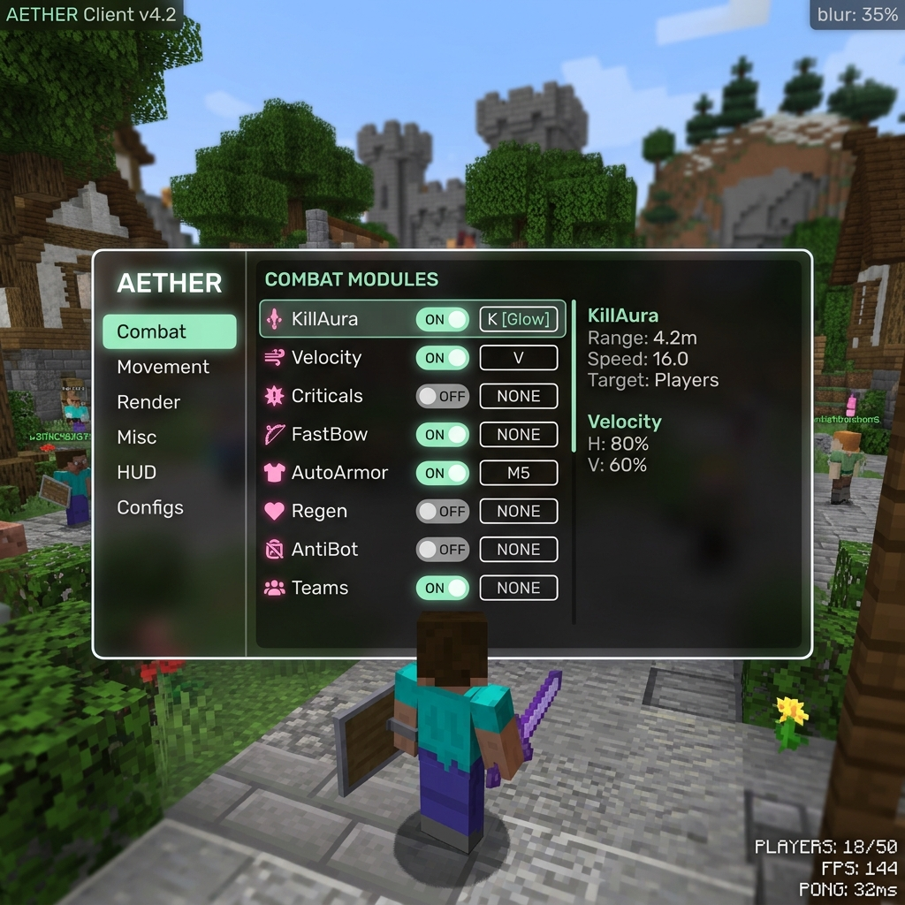

# HackMineCrafft

**HackMineCrafft** — Fabric-клиент для Minecraft **1.20 - 1.20.1** с меню в стиле liquid glass, модулями и кастомным UI.



Открытие меню: **Right Shift**

## Установка

### Для Fabric (1.20 - 1.20.1):
1. Установи [Fabric Loader](https://fabricmc.net/use/) для Minecraft 1.20 или 1.20.1
2. Положи в папку `mods`:
   - [Fabric API](https://modrinth.com/mod/fabric-api) (подходящей версии)
   - `hackminecrafft-1.0.0.jar` из [Releases](https://github.com/homychokk/HackMineCrafft/releases)
3. Запусти игру

### Для Forge (1.20.1):
1. Установи Forge для Minecraft 1.20.1
2. Положи в папку `mods`:
   - [Sinytra Connector](https://modrinth.com/mod/connector) (версия для 1.20.1)
   - [Forgified Fabric API](https://modrinth.com/mod/forgified-fabric-api) (версия для 1.20.1)
   - `hackminecrafft-1.0.0.jar` из [Releases](https://github.com/homychokk/HackMineCrafft/releases)
3. Запусти игру

## Возможности (Функции)

### ⚔️ Combat (Бой)
* **KillAura** — автоматическая атака сущностей в радиусе поражения с умной настройкой целей.
* **AutoAttack** — непрерывная автоматическая атака при удерживании кнопки.
* **AutoCrit** — автоматические критические удары (подпрыгивание перед ударом) для нанесения максимального урона.
* **Hitboxes** — увеличение зоны поражения (хитбоксов) врагов для более легкого попадания.
* **Velocity (Anti-Knockback)** — отключение или уменьшение отдачи при получении урона.

### 🏃 Movement (Движение)
* **Fly** — режим свободного полета по миру.
* **Speed** — значительное ускорение ходьбы, бега и прыжков.
* **Glide** — плавное парение / замедленное падение.
* **HighJump** — увеличение высоты прыжка.
* **Spider** — позволяет взбираться по вертикальным стенам как паук.
* **NoFall** — блокировка получения урона при падении с любой высоты.
* **FastFall** — ускорение падения вниз.
* **AutoWalk** — автоматическая ходьба вперед без удержания клавиш.
* **AutoSneak** — постоянный бесшумный режим (приседание).
* **AutoSprint** — автоматический быстрый бег при движении.

### 👁️ Render (Визуальные модули)
* **XRay** — просвечивание блоков для подсветки ценных руд (алмазы, золото, железо и др.).
* **StorageESP** — подсветка контуров сундуков, печек, шалкеров и других контейнеров сквозь стены.
* **Fullbright** — режим ночного зрения, убирающий темноту в пещерах и ночью.
* **FreeCam** — свободная камера (полет сквозь стены) с возможностью открывать сундуки на расстоянии.
* **Zoom** — плавное оптическое приближение камеры.
* **JumpCircle** — визуальные круги на земле, расходящиеся при прыжках.
* **HandTweaks** — кастомизация положения рук и предметов на экране.

### 🛠️ Misc (Разное)
* **Nuker** — автоматическое мгновенное ломание всех блоков в определенном радиусе.
* **AutoFarm** — авто-фермер (автоматический сбор созревшего урожая и засаживание грядок).
* **AutoTool** — автоматический выбор наилучшего инструмента в руке при ломании блока.
* **AntiAFK** — защита от кика за бездействие (имитация случайных движений).
* **Scaffold** — автоматическое создание платформы / моста из блоков прямо под ногами во время ходьбы или бега.

## Сборка

```bash
# Java 17+
gradle build
```

Готовый jar: `build/libs/hackminecrafft-1.0.0.jar`

## Лицензия

MIT — см. [LICENSE](LICENSE)
